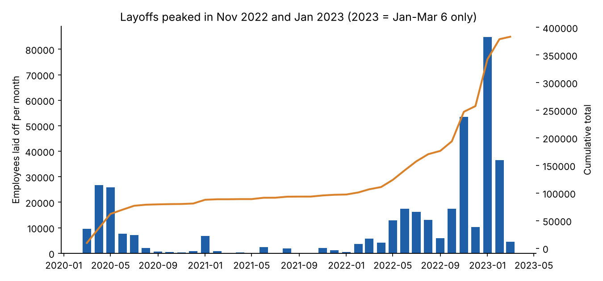
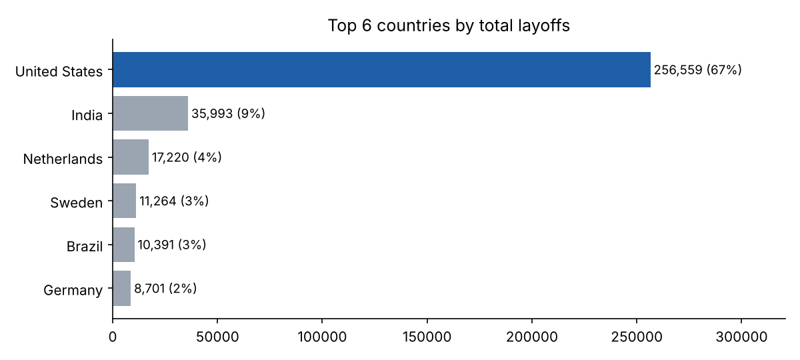
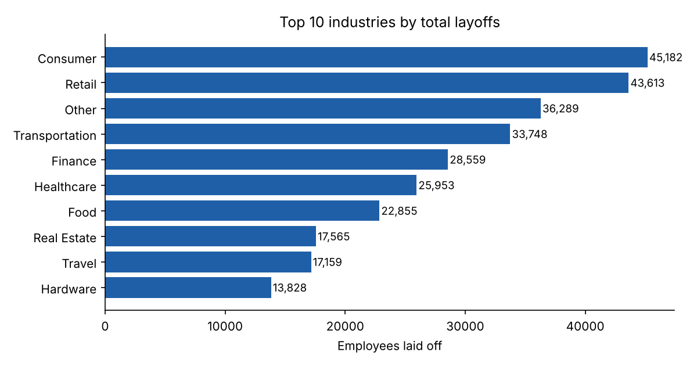
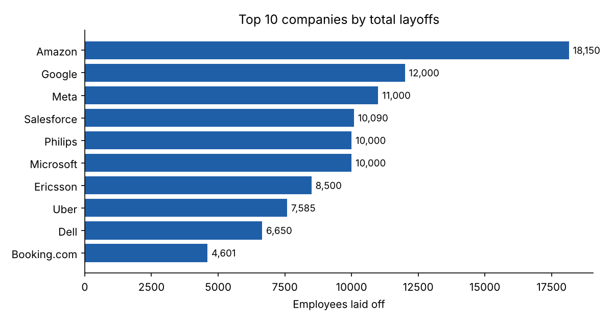

# Global Layoffs Analysis (MySQL)

An end-to-end SQL project: import a raw layoffs dataset, clean it, validate it, and explore it to answer **who laid off the most people, when, where, and what kind of companies were hit hardest.**

**Stack:** MySQL 8.0 · SQL · Python/matplotlib (charts only)

---

## Key Findings

> 1,995 layoff events · 1,628 companies · 51 countries · **383,659 employees** · 11 Mar 2020 to 6 Mar 2023



1. **Layoffs came in two waves, with a quiet year between.**
   - COVID shock: Mar to May 2020 saw 62,142 layoffs.
   - 2021 was calm, with only 15,823.
   - The second wave ran Nov 2022 to Feb 2023: 184,987 layoffs, about **48% of the whole dataset** in four months.
   - January 2023 is the single worst month (84,714).
2. **Big Tech drove the volume.** Amazon (18,150), Google (12,000) and Meta (11,000) lead; the 5 largest single events were all 8,500+ employees (Google, Meta, Amazon, Microsoft, Ericsson).
3. **Mature, public companies account for most headcount.** Post-IPO companies cut 204,132 jobs, **53%** of the total.
4. **The U.S. is two-thirds of the story.** The United States accounts for 256,559 layoffs (**66.9%**), followed by India (9.4%) and the Netherlands (4.5%). The SF Bay Area alone has 125,631 (about a third of all layoffs).
5. **Biggest in numbers is not deepest in percentage.**
   - By headcount, Consumer (45,182) and Retail (43,613) lead.
   - By share of workforce cut, Education (35.7%) and Travel (34.9%) are highest, while Sales (11.0%) and Security (15.8%) are lowest (industries with 10+ records).
6. **116 companies laid off 100% of their staff.** Most were early-stage: Unknown (34), Seed (23) and Series B (19) stages lead. Well-funded exceptions exist: Britishvolt ($2.4B raised) and Quibi ($1.8B).

| Top countries | Top industries |
|---|---|
|  |  |



### What this suggests
- **Different risk by company type:** large public companies cut the most people, but small and early-stage firms were most likely to disappear entirely.
- **Timing matters:** layoffs cluster in short bursts, so a single month can outweigh a whole year.
- **Sector patterns:** consumer-facing sectors (Education, Travel, Food, Retail) were cut deepest in percentage terms.

These are descriptive patterns, not causal claims.

---

## Repository Structure
```
layoffs-sql-project/
├── data/
│   ├── layoffs_raw.csv       # raw dataset (2,361 rows)
│   └── layoffs_cleaned.csv   # cleaned output (1,995 rows), ready for Excel, Tableau or Power BI
├── images/                   # charts used in this README
├── sql/
│   ├── 01_setup.sql          # create schema and load the raw CSV
│   ├── 02_cleaning.sql       # remove duplicates, standardize, fix types, handle NULLs
│   ├── 03_analysis.sql       # trends, rankings, rolling totals
│   └── 04_validation.sql     # 12 automated PASS/FAIL quality checks
├── .gitattributes            # makes GitHub show SQL as the repo language
├── README.md
└── make_charts.py            # Visualizing data

```

## How to Run
Requires **MySQL 8.0+** (window functions and CTEs).

```bash
# 1. Edit sql/01_setup.sql: replace <PATH_TO_REPO> with your absolute path
# 2. Run the scripts in order
mysql --local-infile=1 -u <user> -p < sql/01_setup.sql
mysql -u <user> -p world_layoffs < sql/02_cleaning.sql
mysql -u <user> -p world_layoffs < sql/03_analysis.sql
mysql -u <user> -p world_layoffs < sql/04_validation.sql   # every row should say PASS
```
Prefer a GUI? Import `data/layoffs_raw.csv` into a `layoffs` table with MySQL Workbench's Table Data Import Wizard, then run scripts 02 to 04.

## Data Dictionary
| Column | Type (after cleaning) | Description |
|---|---|---|
| company | text | Company name |
| location | text | City / metro area |
| industry | text | Industry sector |
| total_laid_off | int | Employees laid off (NULL if not reported) |
| percentage_laid_off | decimal(6,4) | Share of workforce laid off, 0-1 (NULL if not reported) |
| date | date | Date of the layoff announcement |
| stage | text | Funding stage (Seed ... Post-IPO) |
| country | text | Country |
| funds_raised_millions | decimal(12,4) | Total funds raised, USD millions |

## Data Cleaning Summary
| Step | What was done | Technique |
|---|---|---|
| Staging | Work on copies; raw table untouched | `CREATE TABLE ... LIKE` |
| Duplicates | 5 exact duplicates removed (2,361 → 2,356) | `ROW_NUMBER() OVER (PARTITION BY all columns)` |
| Text | Trimmed company names; one spelling per brand (`Bytedance`/`ByteDance`, `AppGate`/`Appgate`, `ClearCo`/`Clearco`, `CureFit`/`Curefit`, `SalesLoft`/`Salesloft`) | `TRIM`, `CASE`, `LOWER` |
| Labels | `Crypto Currency`/`CryptoCurrency` → `Crypto`; `Fin-Tech` → `Finance`; `United States.` → `United States` | `UPDATE`, `TRIM(TRAILING ...)` |
| Types | `date` text → DATE; `percentage_laid_off` text → DECIMAL(6,4) and `funds_raised_millions` → DECIMAL(12,4), so values like 0.0185 and 0.9755 are not rounded | `STR_TO_DATE`, `ALTER ... MODIFY` |
| Missing industry | Blanks → NULL, then filled from other rows of the same company (e.g. Airbnb → Travel) | Self-join `UPDATE` |
| Unusable rows | 361 rows with neither a headcount nor a percentage removed (2,356 → 1,995) | `DELETE` |

Row counts reconcile with an independent pandas reproduction of the pipeline, and `04_validation.sql` runs 12 checks (every row should say PASS). The row-count check compares against the raw table, so it is not a hardcoded number.

## Limitations
- **2023 is a partial year** (data ends 6 Mar 2023). Do not read its year-over-year drop as a full-year decline.
- **Missing values:** `total_laid_off` is missing in 378 rows and `percentage_laid_off` in 423 of the cleaned rows, so totals are a lower bound.
- **One undated record** (500 layoffs) is excluded from time-based queries.
- **Exact-match deduplication only.** Near-duplicates (same company, date and headcount with a different secondary field) are not removed. Example: Oda has three 2022-11-01 rows of 70 with different percentages, countries and funding figures.
- **Bally's Interactive** keeps a NULL industry because no other record exists to copy from.
- Data is compiled from public reports and is not an official count.

## Skills Demonstrated
Data cleaning · CTEs · Window functions (`ROW_NUMBER`, `DENSE_RANK`, `LAG`, running `SUM`) · Self-joins · Aggregation · Data validation · Reproducible pipelines · Data storytelling

## Dataset
[Layoffs 2022 on Kaggle](https://www.kaggle.com/datasets/swaptr/layoffs-2022). The dataset remains subject to its original license and terms.

## Acknowledgements
Special thanks to Alex Freberg. His structured SQL curriculum was instrumental in my mastery of core database concepts and gave me the starting workflow for this project (duplicates → standardize → NULLs → remove).

I then extended it with a numeric type fix for `percentage_laid_off`, `Fin-Tech`/`Finance` and company-name standardization, a reproducible import script, 12 automated validation checks, additional analyses (location, funding stage, year-over-year, shutdowns by stage), charts and a cleaned export.
